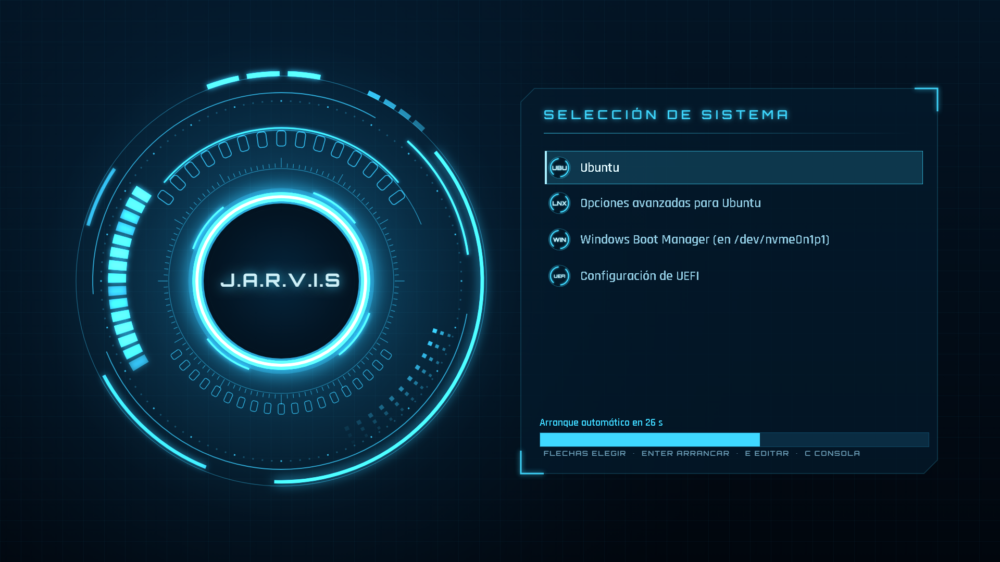

# Jarvis GRUB Theme

Tema visual estilo HUD para el menú de arranque GRUB, con iconos para cada sistema operativo y cuenta atrás animada.



## Requisitos

- Un PC que arranque con **GRUB** (por ejemplo, Linux instalado junto a Windows).
- Acceso a una terminal de Linux con permisos `sudo`.
- Probado en una máquina virtual con GRUB 2.12. El instalador contempla distribuciones basadas en Ubuntu, Debian, Fedora y Arch.

> Todos los comandos se ejecutan **desde Linux**, no desde Windows.

## Instalación

### 1. Descarga el paquete

**Si el repositorio es privado:**

1. En Linux, abre el navegador e inicia sesión en GitHub.
2. Abre este repositorio y pulsa sobre `jarvis-grub-theme.tar.gz`.
3. Pulsa el botón de descarga.
4. Mueve el archivo de **Descargas** a tu **Carpeta personal**.

**Si el repositorio es público**, puedes descargarlo desde la terminal:

```bash
curl -L -o ~/jarvis-grub-theme.tar.gz https://github.com/Andre-2408/jarvis-grub/raw/main/jarvis-grub-theme.tar.gz
```

### 2. Descomprime el paquete

Abre una terminal con `Ctrl + Alt + T` y ejecuta:

```bash
cd ~ && tar -xzf jarvis-grub-theme.tar.gz
```

### 3. Entra en la carpeta

```bash
cd ~/grub-theme
```

### 4. Ejecuta el instalador

```bash
sudo bash install.sh
```

Te pedirá tu contraseña de Linux. Es normal que no se vea nada mientras la escribes.

### 5. Reinicia

Cuando aparezca el mensaje `¡Listo! Reinicia para ver a Jarvis en el arranque.`, ejecuta:

```bash
sudo reboot
```

## Uso del menú

| Tecla | Acción |
|---|---|
| Flechas arriba y abajo | Elegir sistema |
| `Enter` | Arrancar el sistema elegido |
| `E` | Editar la entrada |
| `C` | Abrir la consola de GRUB |

## Qué hace el instalador

- Guarda una copia de seguridad en `/var/backups/jarvis-grub/`.
- Copia el tema en la carpeta de GRUB y genera sus fuentes.
- Ajusta `/etc/default/grub` para que el menú gráfico sea visible.
- Comprueba la configuración nueva **antes** de aplicarla.
- Cancela y deshace los cambios si algo falla o si Windows fuera a desaparecer del menú.

## Desinstalación

```bash
cd ~/grub-theme && sudo bash uninstall.sh
```

Después reinicia. GRUB volverá a verse como antes.

## Solución de problemas

**El instalador dice que Windows desaparecería del menú.** Tu arranque no se ha modificado. Activa la detección de otros sistemas y vuelve a instalar:

```bash
echo 'GRUB_DISABLE_OS_PROBER=false' | sudo tee -a /etc/default/grub
```

En Ubuntu y Debian, instala también la herramienta de detección:

```bash
sudo apt install os-prober
```

**No se ve el tema al reiniciar.** Comprueba que quedó configurado:

```bash
grep GRUB_THEME /etc/default/grub
```

**El menú no aparece y arranca directamente.** Mantén pulsada la tecla `Esc` o `Shift` justo al encender el PC.

**Se ve estirado o pequeño.** El tema está diseñado para 1920x1080. Puedes fijar la resolución de tu pantalla añadiendo una línea como esta en `/etc/default/grub`:

```text
GRUB_GFXMODE=1920x1080
```

Después aplica el cambio con `sudo update-grub` en Ubuntu y Debian, o con `sudo grub-mkconfig -o /boot/grub/grub.cfg` en Arch.

## Licencias

Las fuentes Orbitron y Rajdhani se distribuyen bajo la licencia SIL Open Font License. Sus textos están en la carpeta `fonts-src/` del paquete.
